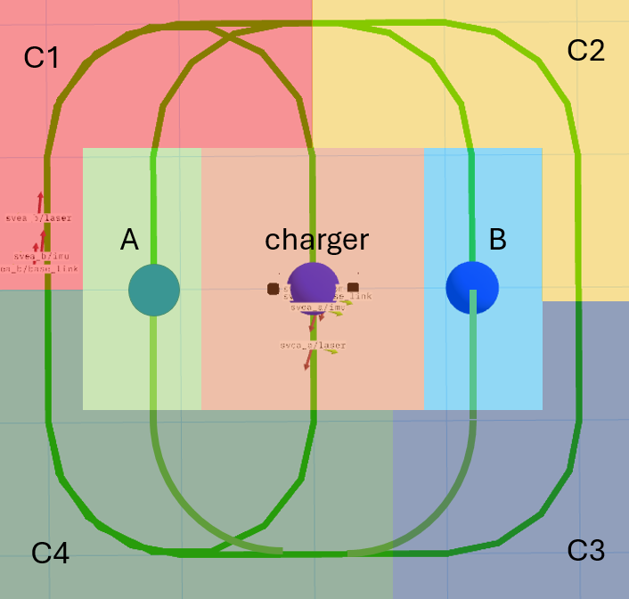

# Smart Charging Management readme
This README contains high level documentation about the codes of the charging management experiment framework on 2 SVEAs. To read what the code was used for, check out the report or the video (https://youtu.be/8vSmdKMjPsw).

## Launching
The experiment can be run using 2 SVEAs, 1 real and 1 simulated (mixed-reality) or 2 simulated SVEAs. There is a specific launch file per usecase. 
In case of the mixed reality, run the container both on the svea and your laptop. The laptop simulates the svea. Launch, on the SVEA:
```Bash
bl svea_charging hybrid_expt_launch.py --is_sim False
```

on your laptop:
```bash
bl svea_charging hybrid_exp_launch.py --is_sim True
```

This configuration is untested in the newest 2 commits as the communication structure was changed. Revert to commit bc5b3b9, "prepped for use with 2 sveas" to switch back to using Zenoh. In that case, dont forget to launch a zenoh router on the SVEA by running in the container: 
```bash
ros2 run rmw_zenoh_cpp rmw_zenohd
```
Check that your laptop inherits the correct settings for connecting, see util/run lines 15 to 29 and use AI to figure out whats going on and which lines to (un)comment for your configuration. 


To do the experiment with 2 sveas in real life, instead toggle the correct setting using the name. Use the newest commit for working communication ;) launch on svea3:
```bash
bl svea_charging two_svea_exp_launch.py --name "svea_a" --use_domain_bridge True
```
on the other svea, this case svea2, launch:
```bash
bl svea_charging two_svea_exp_launch.py --name "svea_b"
```

To launch the simulator:
```bash
bl svea_charging simulator_bt_charging.launch.py
``` 

## Architecture
Each SVEA runs its own code stack. The idea is that a svea executes all autonomous related tasks and computations itself, and listens to the central controllers commands. Check the launch files above to see which nodes are launched with what settings.
  
The experiment is run by the centralized controller "exp_runner.py". It is only launched on one svea. It handles all the logic about the experiment, computes the next task, etc. It sends mission/action to each svea. It can be "charge_cycle", "transport" or "wait". In case of a transport mission the mission/transport_length is published as short/mid/long. When charging is done, mission/charge_done publishes True. This is all the communication between the centralized controller and the SVEAs. A SVEA will start executing an action if the appropriate messages are received. Check out the behaviour tree to see how the logic is handled on the SVEA level. 
  
The SVEAs communicate to the central controller only their battery state and vehicle status. The vehicle status communicates when a svea is finished with a task. 

Between the SVEAs, there is also communication. They communicate to each other in which zone they are, to prevent collisions. The cyclinder control mux deals with this by disabling control commands in the vehicle that entered a region last. 



## Smart Charging Management codes
The codes related to the smart charging management are all in svea_charging/scripts/management/
There is also a README in that folder, explaining the basics of the management. 
Note that it also includes the files to run the event-based simulator as mentioned in the report. run run.py to use it. In that case, the configuration in scenario.py is used for the experiment. When using ROS, the settings are overwritten by the launch file.  
Should you wish to change anything about the optimization algorithm itself, adjust planner.py.
Do you want to change rules about how the experiment is handled, how to deal with exceptions, or anything else experiment related, adjust exp_runner.py.